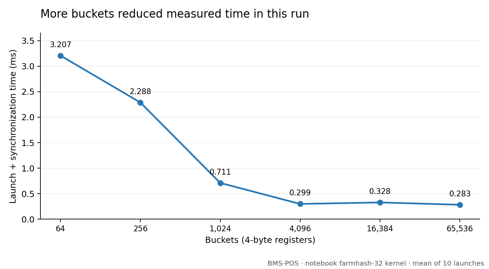

# Why did more buckets make it faster?

In the BMS-POS experiment, increasing the HyperLogLog bucket count reduced the measured time from **3.207 ms at 64 buckets to 0.283 ms at 65,536 buckets**, about **11.3× faster**. The input and thread-block size stayed the same.



These are saved results from the first Experiment B in [the notebook](../../cuda-hyperloglog.ipynb), using its `farmhash-32` kernel. The parsed input contains 6,733,169 items and 515,553 distinct values. This is not a new benchmark run; the presentation has different timing values.

## My guess: less contention

Each thread hashes an item, chooses a bucket, and updates that bucket with:

```cuda
atomicMax(&regs[bucket], lz);
```

With only 64 buckets, many threads target the same small set of addresses. More buckets can spread those updates out and reduce contention. The launch still uses 256 threads per block and the same number of blocks, so this isn't a case of launching more threads.

That's my hypothesis, not a measured explanation. Repeated copies of the same item still go to the same bucket. Cache behaviour and the input distribution could also affect the result. [NVIDIA's atomic-operation documentation](https://docs.nvidia.com/cuda/archive/12.9.2/cuda-c-programming-guide/index.html#atomic-functions) explains the update operation.

## What still needs checking

The notebook averages 10 launches using `time.time()` around the launch and a stream synchronization. That includes host overhead. It clears the registers once before the timed loop, so later launches reuse an already-filled sketch.

A better follow-up would reset and synchronize the registers before each sample, time the kernel with CUDA events, and report variation between runs. Then profile the atomic updates and cache behaviour to test the contention explanation. [CuPy recommends event-based timing and warm-up runs](https://docs.cupy.dev/en/stable/user_guide/performance.html).

More buckets didn't help at every step: 16,384 was slower than 4,096 in this run. They also use more memory. The lowest measured error was at 1,024 buckets, so the fastest configuration wasn't the most accurate one here.
